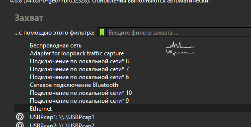
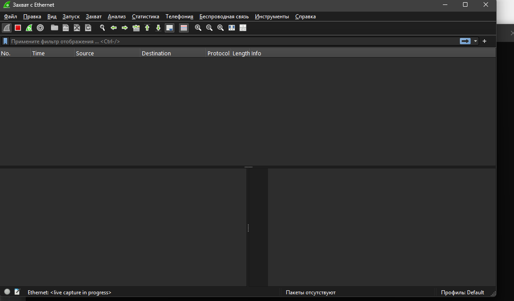
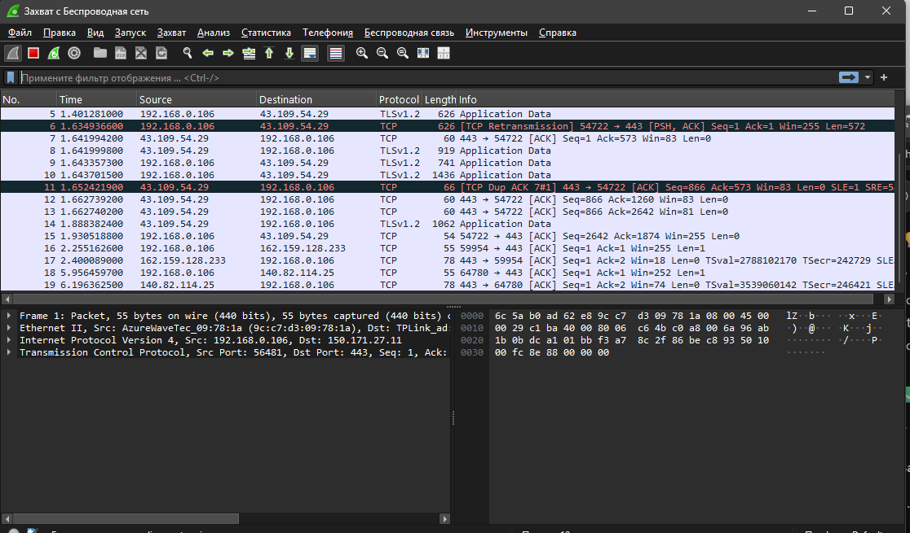

### Имя: Геращенко Ксения 
### Группа: РПО2/3 

Я установаила Wireshark, но проблема в том, что я прочитала вашу презентацию и еще почитала дополнительно и запустив отслеживание ethernet, совершив активность открытием сайтов и ping 8.8.8.8 в цмдешке, у меня не появилась нкиакая активность спустя минут 4, и я немного не поняла должно ли так быть, а если нет, то я не смогла найти нормального решения, поэтому я заскринела активность беспроводной сети :((

