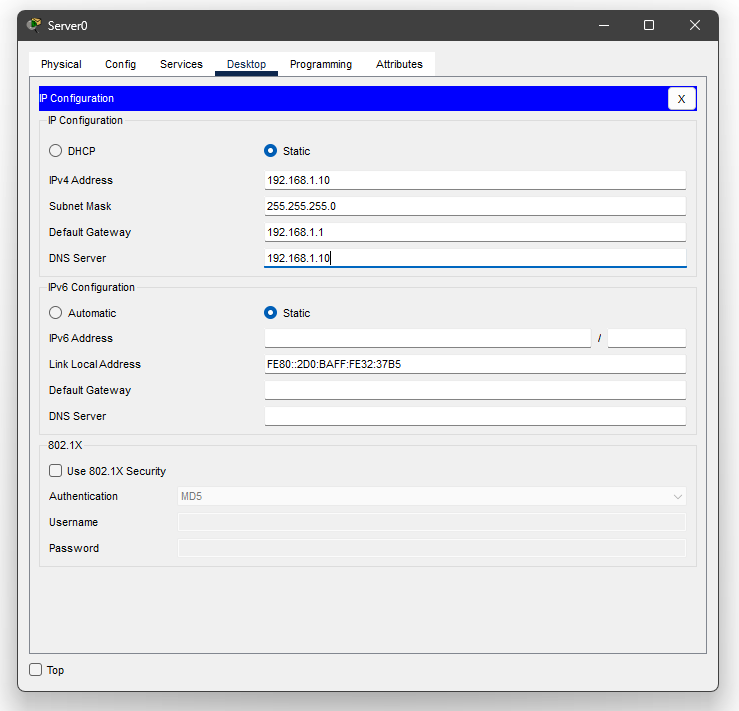
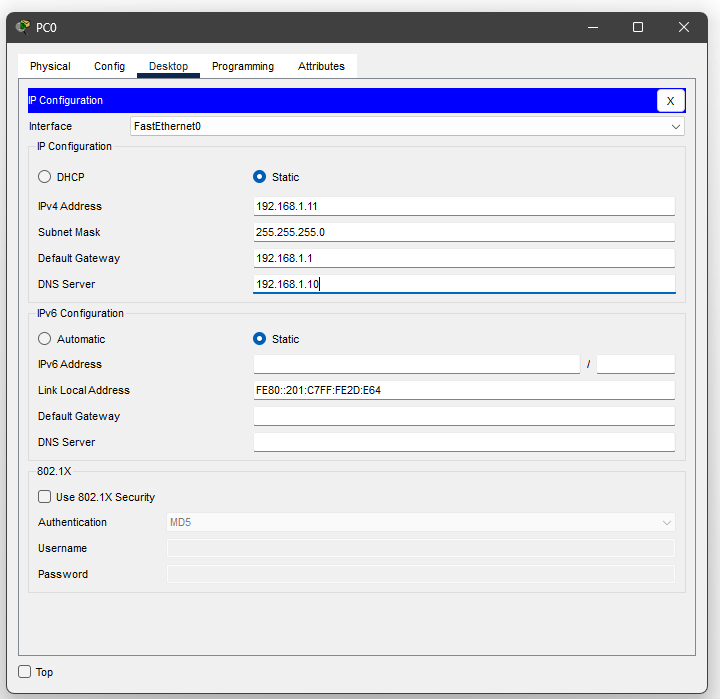
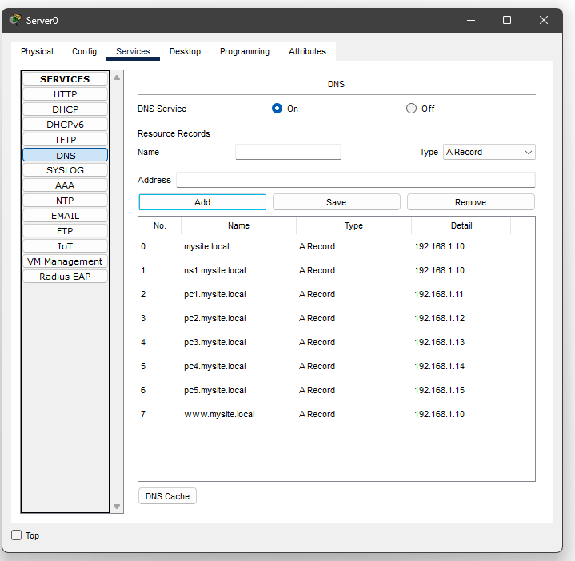
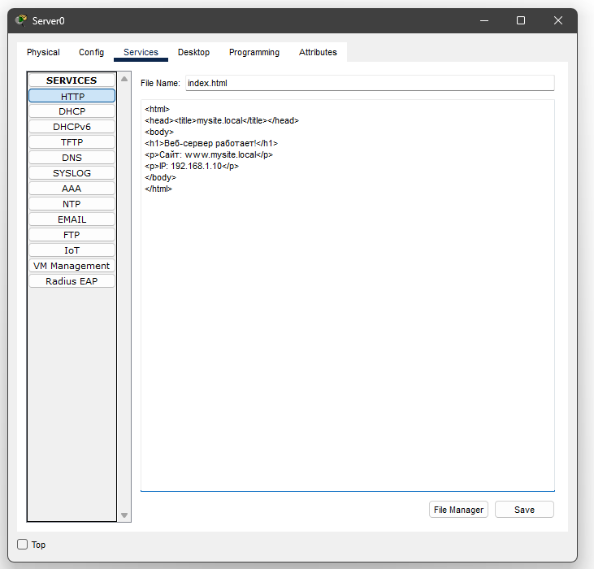
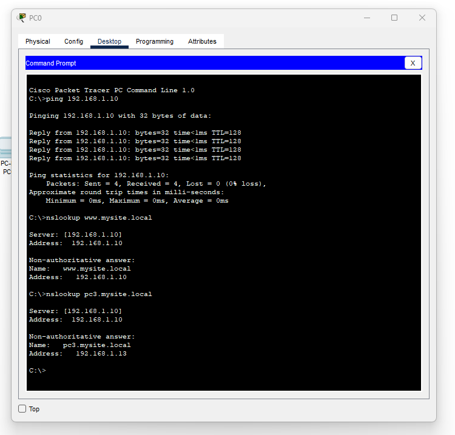
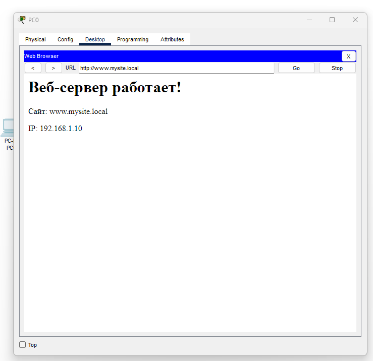
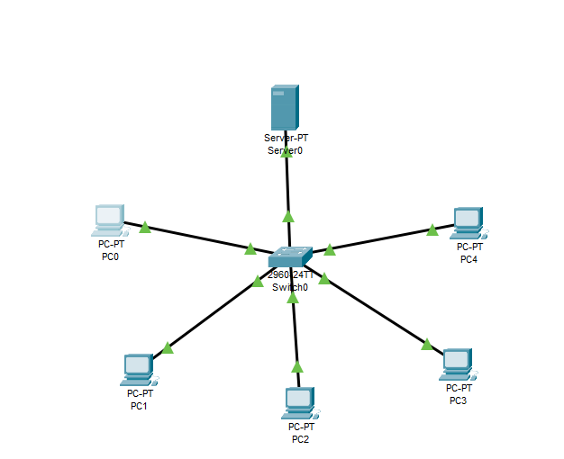

### Ученик: Геращенко Ксения Игоревна
### Группа: РПО2-9\3
### Тема: DNS-записи и диагностика ошибок имен

## Настройка IP-адресов

## PC0 – PC4

## Настройка DNS-сервера

## Настройка веб-сервера

## Проверка с клиента PC0-4

## Desktop → Web Browser

## Сама схема

