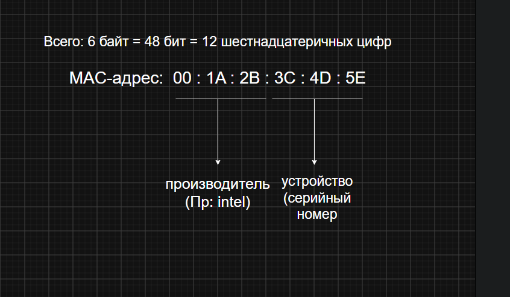
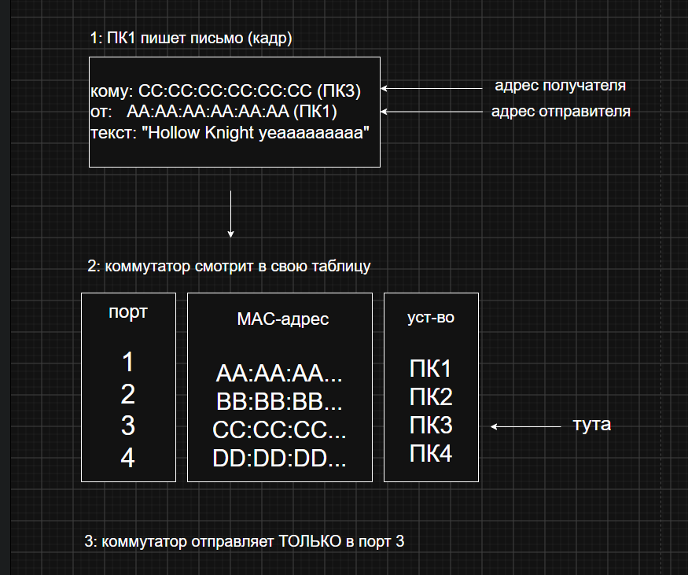

### Имя: Ксения Геращенко 
### Группа: РПО2/3 Дата:11.09.2026

Наша ситуация ПК1 хочет отправить данные ПК3

## Ошибки и как исправить:
1. у нас два уст-ва с одинаковым мак-адресом
коммутатор путается, куда отправлять данные, типо связь то есть, то нетк
Решение: отключить одно уст-во, поменять ему макдрес

2. два кабеля соединяют одни и те же устройства
данные бегают по кругу и забивают всю сеть после чего все как бы встает
Решеине: убрать лишний кабель, включить stp (он сам блокирует лишние линии)

3. компьютер переставили в другой порт
коммутатор помнит старый порт и шлет данные туда, где никого нет, связь появится только через 5-10 мин
Решение: очистить таблицу командой clear mac address-table

4. неправильная ручная запись
админ прописал мак не на тот порт, данные уходят не туда
Решение: удалить запись и прописать правильную

5. одинаковый IP у двух уст-в
это конфликт адресов и у обоих пропадает связь
Решение: найти конфликт, назначить правильный IP

6. порт заблокирован защитой (err-disabled) ойойой
коммутатор сам отключил порт .... подключили второе уст-во, воткнули коммутатор в порт доступа или слишком много трафика
Решение: убрать причину, перезапустить порт (shutdown)

7. разная скорость
один конец кабеля работает в полном дуплексе, другой в полудуплексе, пакеты теряются, скорость падает
Решение: выставить одинаковые настройки с обеих сторон

8. ууупс сломана сетевая карта
карта шлет бесконечный поток данных, грузит всю сеть
Решение: отключить порт, заменить карту
