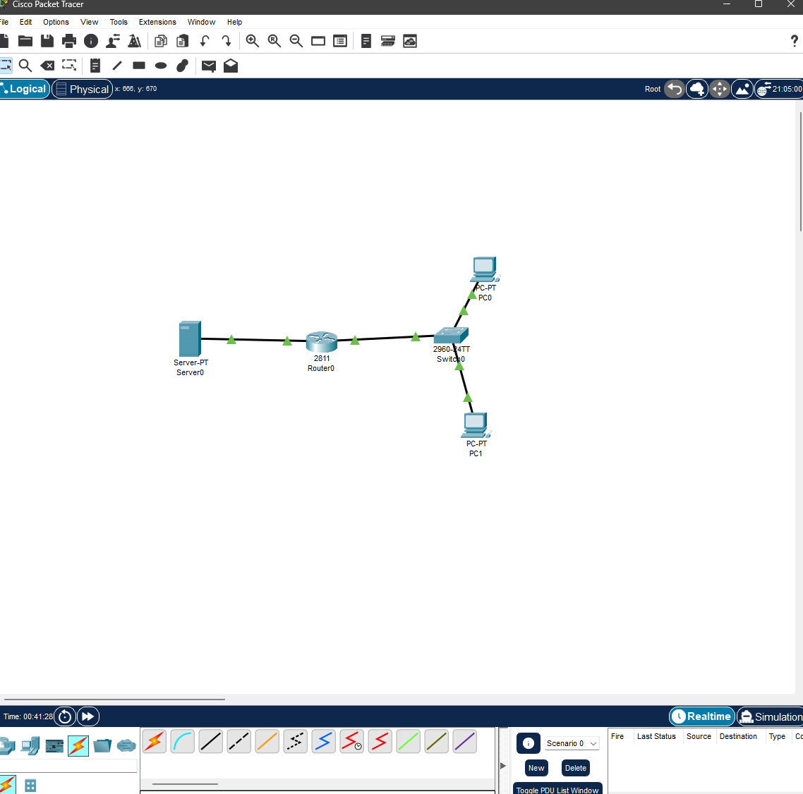
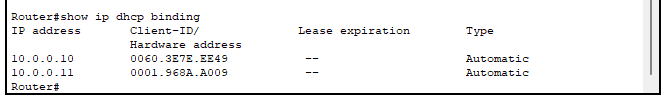
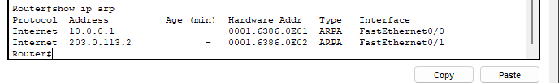
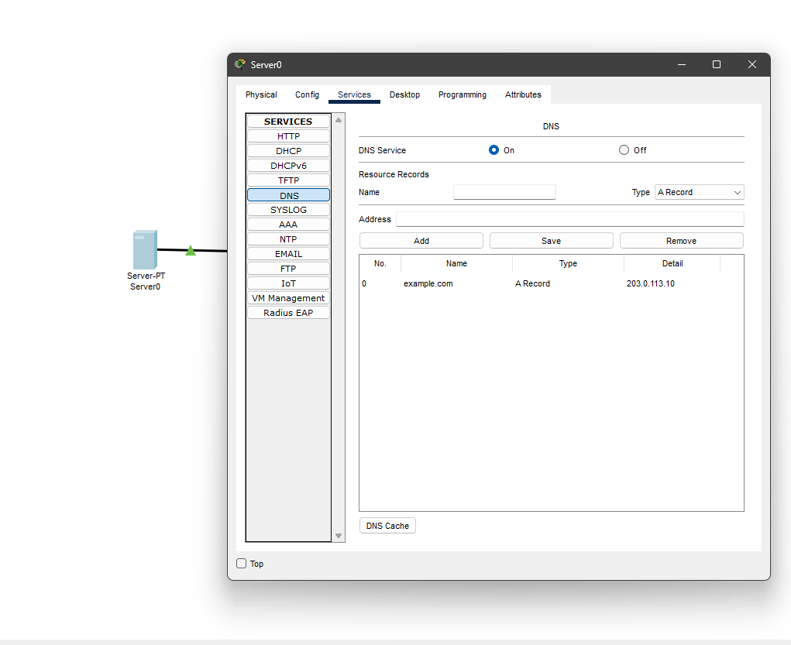
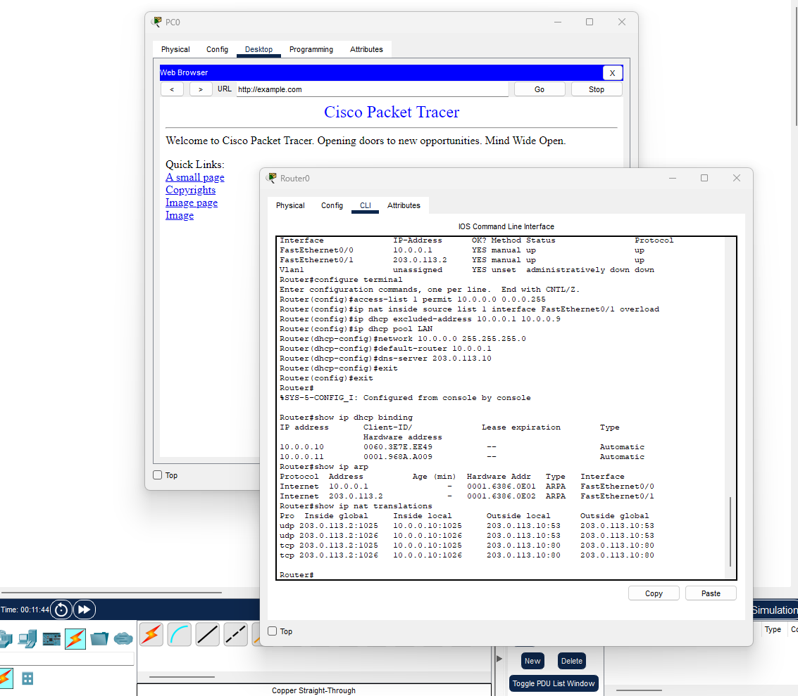
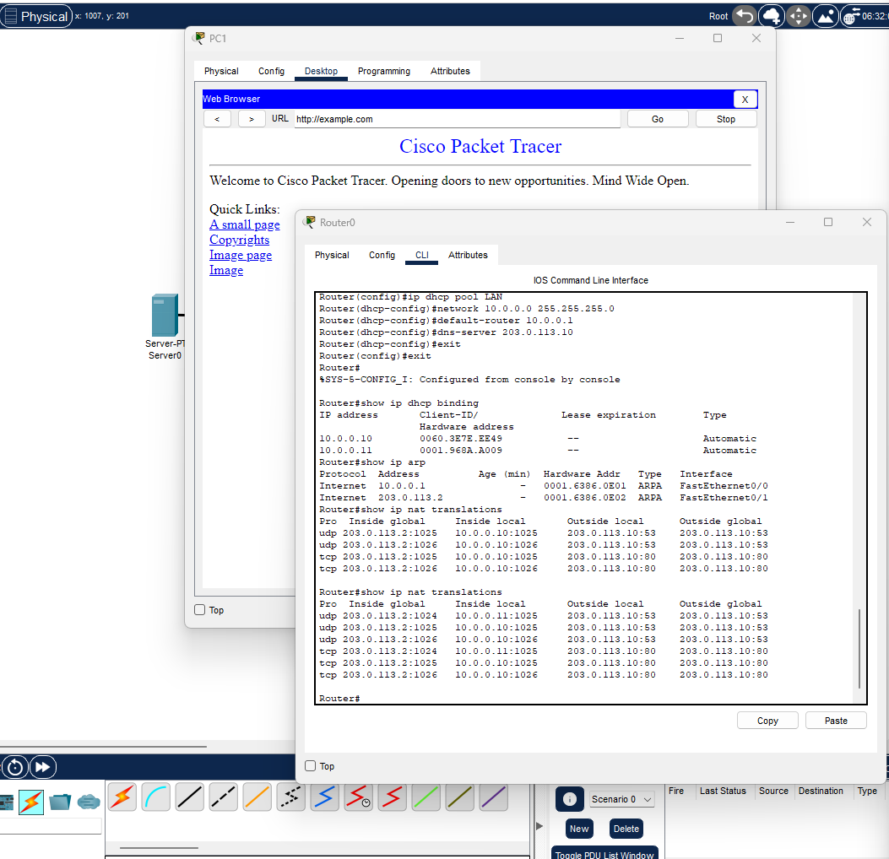

# Экзаменационная работа Билет 7: Настройка NAT, PAT и DHCP

**Билет 7. «NAT и PAT в действии»**
- Частная сеть 10.0.0.0/24 + пограничный роутер + внешний сервер.
- Рассчитать подсеть, назначить адреса.
- Проверить ARP и MAC-таблицы до NAT.
- Настроить статический NAT и PAT (overload).
- DHCP для внутренних ПК.
- DNS-сервер во внешней сети.
- Проверить HTTP/HTTPS через NAT.
- **Отчёт:** таблица трансляций, как меняются IP/порты.

## 1. Расчет подсети и назначение адресов
- внутренняя сеть: **10.0.0.0/24** маска `255.255.255.0`
- внешняя сеть: **203.0.113.0/24**

Значит берем 2 Пк, 1 роутер 2811 и сервер, соединяем их между собой сплошным проводом черным

## 2. Проверка DHCP и ARP-таблиц до NAT 

Командой `show ip dhcp binding` показано, что ПК успешно получили адреса

Командой `show ip arp` проверена таблица ARP, роутер видит свои интерфейсы по MAC адресам

## 3. Настройка DNS-сервера во внешней сети

На внешнем сервере включен сервис DNS, добавлена запись `example.com 203.0.113.10`, в настройках DHCP на роутере этот сервер указан как основной DNS для внутренних пк

## 4. Настройка NAT и PAT overload

*   **PAT:** настроен с помощью `access-list 10.0.0.0 0.0.0.255` и команды `ip nat inside source list 1 interface FastEthernet0/1 overload`, все пк выходят в интернет через один внешний айпи
*   **NAT:** Нету статического ната тк нет внутренних серверов, требующих доступа извне

## 5. Проверка HTTP/HTTPS через NAT

С компьютеров PC0 и PC1 открыт сайт `http://example.com`, запрос успешно прошел через NAT

Скриншоты с доказательством ниже, там видно сайт на пк 0 и 1 и таблица в роутере заодно

## 6. Таблица как меняются IP и порты

По команде `show ip nat translations`:

**ПК 0:**

**ПК 1:**

